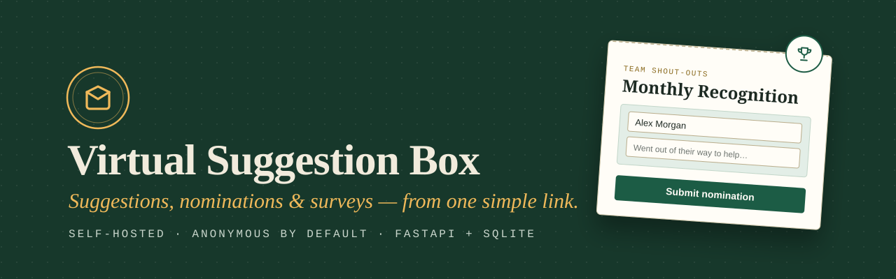
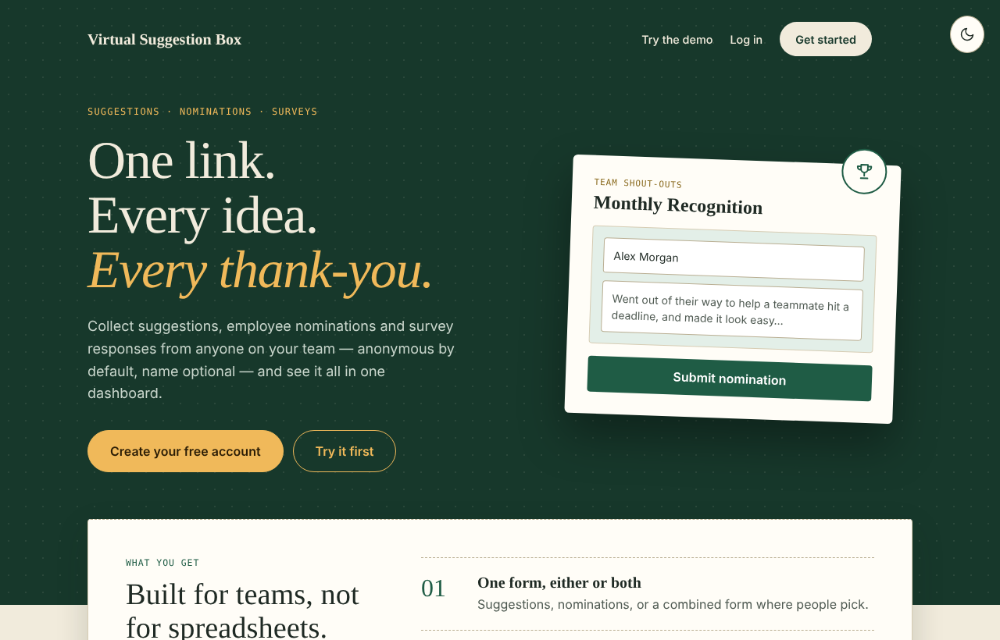
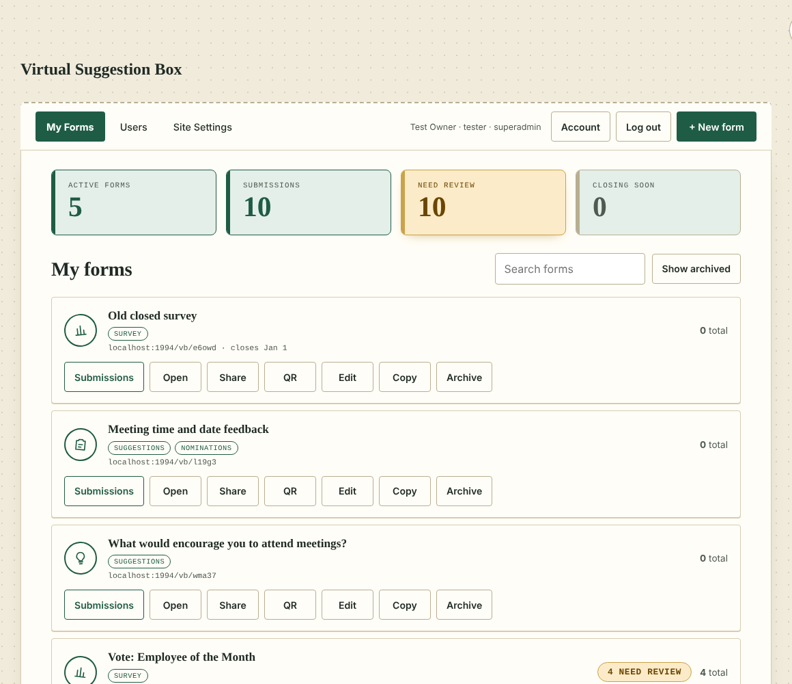
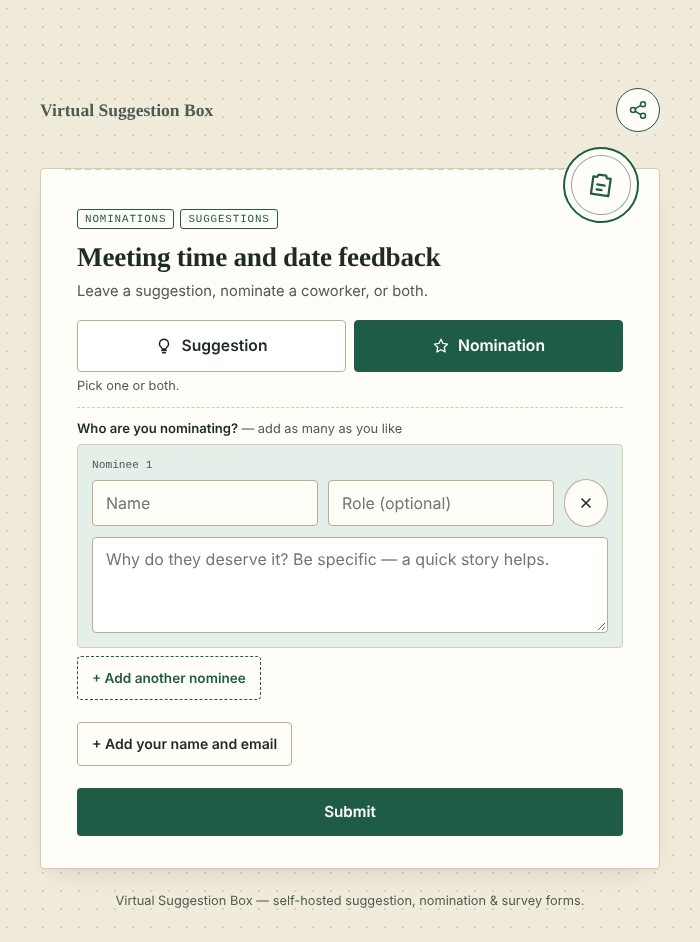
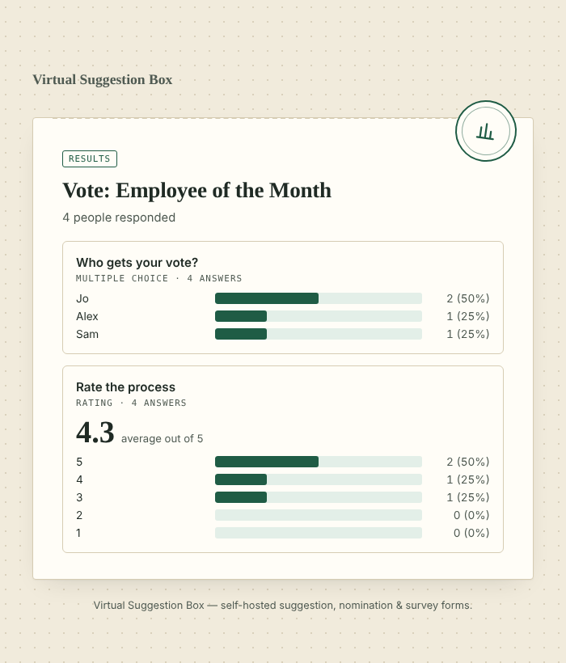
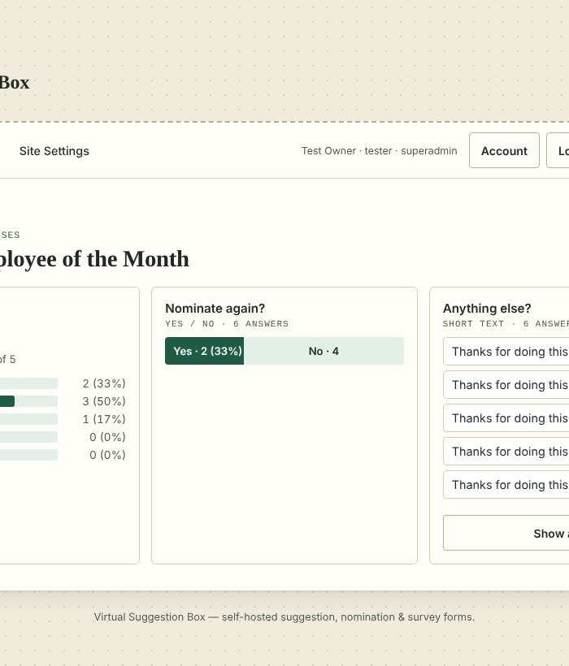
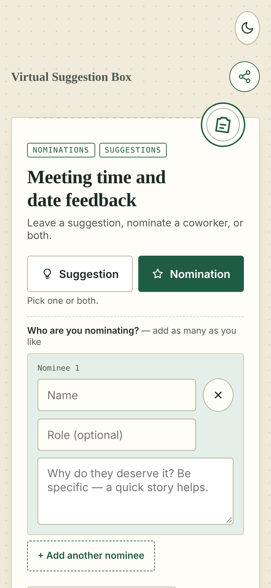

<div align="center">



<br>


**Share one link. People drop in ideas, nominate a coworker, or answer a survey —  
anonymous by default, name optional. You see it all in one dashboard.**

[Features](#-features) · [Screenshots](#-screenshots) · [Quick start](#-quick-start) · [Deploy](#-deploy-on-a-raspberry-pi) · [Configuration](#-configuration) · [Full guide](docs/GUIDE.md)

</div>

<br>

## ✦ What it is

Virtual Suggestion Box is a small, self-hosted web app for collecting feedback and recognition from a team. One form can take **suggestions**, **employee nominations**, **survey answers**, or any mix of the three. There's no build step, no external database, and no front-end framework: just FastAPI, SQLite and plain HTML/CSS/JS.

It was built for a real emergency department's Employee of the Month nominations and has been in live use since, so the defaults lean toward *safe and simple* over *clever*.

## ✦ Features

| | |
|---|---|
| **📝 One form, three ways** | Suggestions, nominations, surveys, or a combined form where people pick which to fill in. |
| **🕶️ Anonymous by default** | Every form accepts anonymous submissions. A name (and an optional email for a 24-hour view link) is never required. |
| **🏆 Real nominations** | Nominate one person or a whole team in a single submission, each with a role and their own reason. |
| **📊 Surveys with live results** | Short text, multiple choice, 1–5 rating and yes/no questions. Start from a template. Share results as charts, or keep them private. |
| **👥 Share without losing control** | Give teammates view access to a form's submissions, or hand off ownership entirely. Admins and superadmins can see everything. |
| **🔔 Notifications** | Per-person email and webhook notifications for each form's new submissions. |
| **🗂️ Organise** | Groups, archiving, copying, expiry dates, QR codes and share links. |
| **🔐 Secure by default** | Two-factor login (TOTP) with recovery codes, session management, login lockout and rate-limited public submissions. |
| **📤 Your data, your way** | CSV export of any form, full JSON backups, and a scheduled backup script. |
| **🌗 Light and dark** | Follows the device's setting, with a toggle on every page. Fully responsive. |

## ✦ Screenshots

<table>
<tr>
<td width="50%" valign="top">
<b>Home page</b><br>
<picture>
  <source media="(prefers-color-scheme: dark)" srcset="docs/screenshots/home-dark.png">
  
</picture>
</td>
<td width="50%" valign="top">
<b>Dashboard</b><br>
<picture>
  <source media="(prefers-color-scheme: dark)" srcset="docs/screenshots/dashboard-dark.png">
  
</picture>
</td>
</tr>
<tr>
<td width="50%" valign="top">
<b>Public form: suggestion + nomination</b><br>
<picture>
  <source media="(prefers-color-scheme: dark)" srcset="docs/screenshots/form-dark.png">
  
</picture>
</td>
<td width="50%" valign="top">
<b>Survey results</b><br>
<picture>
  <source media="(prefers-color-scheme: dark)" srcset="docs/screenshots/results-dark.png">
  
</picture>
</td>
</tr>
</table>

<details>
<summary><b>Analytics and mobile</b></summary>
<br>
<table>
<tr>
<td width="60%" valign="top">
<picture>
  <source media="(prefers-color-scheme: dark)" srcset="docs/screenshots/analytics-dark.png">
  
</picture>
</td>
<td width="40%" valign="top" align="center">
<picture>
  <source media="(prefers-color-scheme: dark)" srcset="docs/screenshots/mobile-form-dark.png">
  
</picture>
</td>
</tr>
</table>
</details>

## ✦ Quick start

```bash
git clone https://github.com/createdbyct/virtual-suggestion-box.git
cd virtual-suggestion-box

python3 -m venv venv
source venv/bin/activate
pip install -r requirements.txt

python3 run.py            # http://localhost:1994
```

Then:

1. Open `/register` and create your account.
2. Promote yourself (there is deliberately no public path to admin):
   ```bash
   python3 promote_admin.py you@example.com superadmin
   ```
3. Reload `/dashboard`. Create a form, copy its link, and share it.

The SQLite database (`suggestionbox.db`) is created on first run. Schema changes are applied automatically and additively on startup, with a safety copy written first, so **updating never wipes your data**.

## ✦ Deploy on a Raspberry Pi

The app is light enough to run on a Raspberry Pi 2. [`install.md`](install.md) walks through the whole setup:

- flashing a headless OS and installing dependencies
- running it as a `systemd` service
- exposing it with a **Cloudflare Tunnel** (no open ports)
- optional SMTP for password-reset email

**Updating a running install:**

```bash
cd virtual-suggestion-box
git pull
sudo systemctl restart suggestion-box
```

## ✦ Configuration

Everything works with no configuration. These environment variables are optional:

| Variable | Purpose |
|---|---|
| `COOKIE_SECURE` | Set to `true` when serving over HTTPS (e.g. behind a tunnel) so session cookies are marked `Secure`. |
| `PUBLIC_BASE_URL` | Public URL used in emailed links, e.g. `https://suggestions.example.com`. |
| `SMTP_HOST` `SMTP_PORT` `SMTP_USERNAME` `SMTP_PASSWORD` | Outgoing mail for password reset and notifications. Can also be set in **Site Settings**. |
| `SMTP_FROM_EMAIL` `SMTP_FROM_NAME` | Sender address and display name. |

Scheduled backups: run `python3 backup_db.py` from cron to write timestamped JSON backups and prune old ones.

## ✦ Built with

- **[FastAPI](https://fastapi.tiangolo.com/)** and **[SQLAlchemy](https://www.sqlalchemy.org/)** on **SQLite**
- Plain **HTML, CSS and vanilla JS**. No bundler, no framework, no build step
- Standard-library **TOTP** (RFC 6238) and **PBKDF2** password hashing
- Fonts: Fraunces, IBM Plex Sans and IBM Plex Mono

<details>
<summary><b>Project layout</b></summary>

```
.
├── app/
│   ├── main.py            # app setup, routing, static pages
│   ├── models.py          # SQLAlchemy models
│   ├── schemas.py         # Pydantic schemas
│   ├── migrate.py         # additive, in-place schema migrations
│   ├── analytics.py       # survey and submission analytics
│   ├── auth.py  totp.py   # sessions, passwords, two-factor
│   ├── mailer.py  webhook.py
│   ├── backup.py          # JSON export / import
│   ├── routers/           # public, auth, projects, admin, settings
│   └── static/            # all pages, style.css, theme.js
├── docs/                  # README assets and the full guide
├── backup_db.py           # scheduled backup script
├── promote_admin.py       # grant admin / superadmin
├── install.md             # Raspberry Pi deployment walkthrough
└── run.py                 # dev server launcher
```
</details>

## ✦ Documentation

The **[full guide](docs/GUIDE.md)** covers every page, roles and permissions, two-factor authentication, password reset, sessions, rate limiting, form management, survey templates, backups and site settings.

<br>

<div align="center">

Made by **[CREATEDBYCT STUDIO](https://createdbyct.studio)**

</div>
