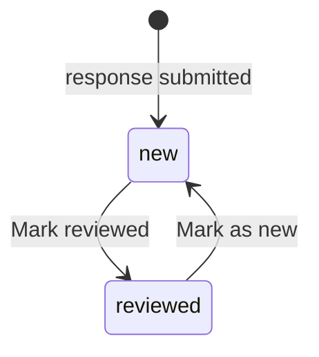
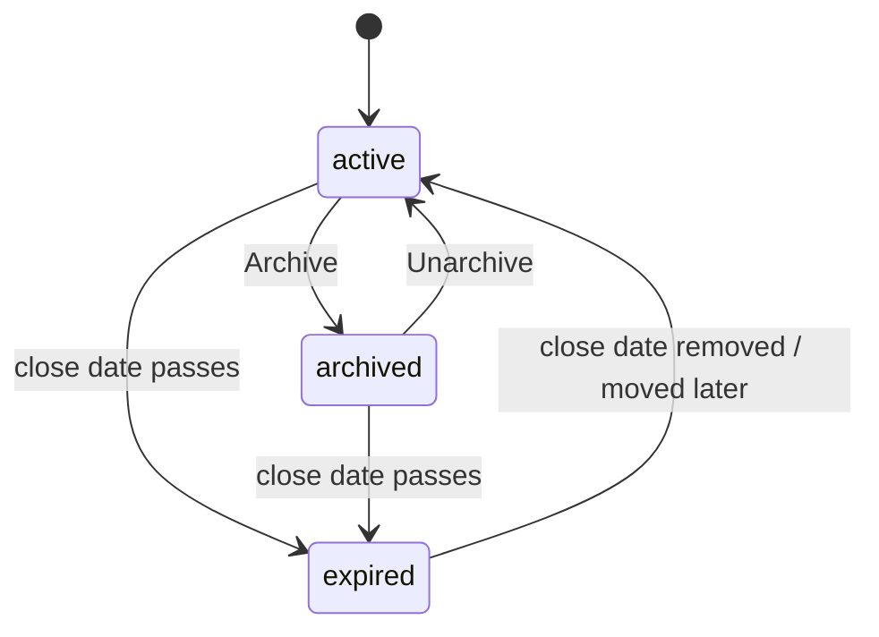
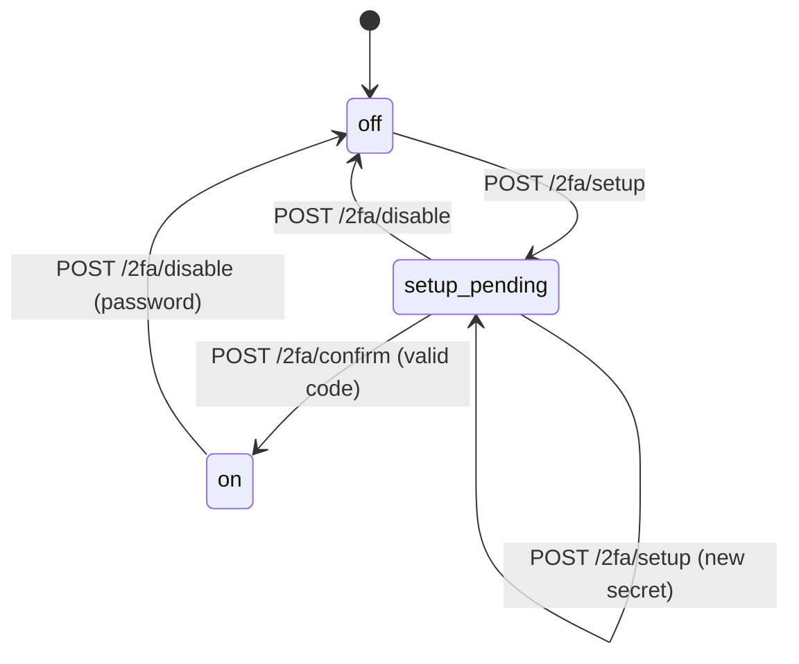
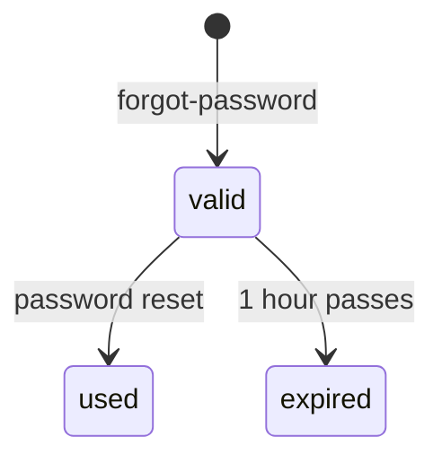
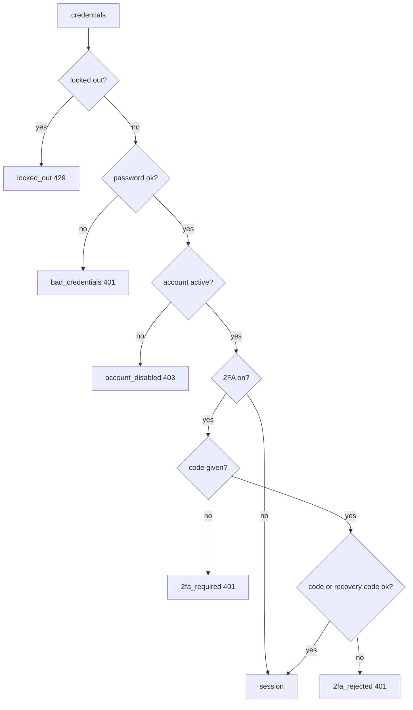

# State machines

Every piece of the app that moves through states is listed here, with where it is stored, how it is enforced, and what a client sees. The single source of truth in code is [`app/states.py`](../app/states.py); `python -m unittest discover -s tests -v` fails if this page and that file disagree.

**Design rule:** states are *derived* from columns the database already has. Nothing here needs a migration, and old data keeps working.

For scripts and AI agents: read the `state` / `next_statuses` fields on API responses instead of recomputing them, and key off the `X-Error-Code` response header instead of matching English error text.

---

## 1. Submission review status

Stored in `submissions.status`. Exposed as `status` plus `next_statuses` (the legal next moves).

| State | Meaning |
|---|---|
| `new` | Needs review (shown as "Needs review") |
| `reviewed` | Someone on the team has looked at it |

- Owners and shared viewers can both move it (review is collaborative).
- Same-state requests succeed (safe to retry a bulk action).
- The retired `done` value is accepted from old clients and treated as `reviewed`; existing `done` rows are converted at startup (with a safety copy of the database).

## 2. Form lifecycle

Derived from `projects.is_archived` and `projects.expires_at`. Exposed as `state` and `accepting_responses` on every form.

| State | Meaning |
|---|---|
| `active` | Open, in the default list |
| `archived` | Tucked away, **still accepts responses** |
| `expired` | Past its close date — public form is closed |

- `expired` wins over `archived` for display; the two flags stay independent.
- Only the close date stops submissions (error code `form_closed`, HTTP 403).

## 3. Two-factor auth

Derived from `users.totp_secret` + `users.totp_enabled`.

| State | Meaning |
|---|---|
| `off` | No secret |
| `setup_pending` | Secret issued, no code confirmed yet |
| `on` | Login requires a code |

- **Fixed:** calling setup while `on` used to silently switch 2FA off. It now returns 409 (`2fa_already_on`); turning it off requires the password.

## 4. User account

`users.role` × `users.is_active`.

| Dimension | Values |
|---|---|
| Role | `owner` < `admin` < `superadmin` |
| Account | `active`, `disabled` |

- Disabled accounts cannot log in (`account_disabled`) and existing sessions stop working.
- Admins cannot change their own role or disable themselves; only a superadmin can touch a superadmin.

## 5. Single-use links

Password-reset links (`password_reset_tokens.used` + `expires_at`).

| State | Meaning |
|---|---|
| `valid` | Unused and not expired (1 hour) |
| `used` | Already consumed |
| `expired` | Past its expiry |
| `unknown` | No such token |

- **Fixed:** resetting a password now also invalidates every *other* outstanding link for that account.
- **Fixed:** asking for a link for an account that doesn't exist now looks identical to asking for one that does, so the form can't be used to find out who has an account.
- **Fixed:** links are only ever emailed — never shown on screen. If the site has no working email, the forgot-password page says to ask an admin (`delivered_via: "admin"`), who resets it from the Users tab with a temporary password; the person then changes it themselves in Settings.
- Failures return `link_invalid` (HTTP 404).

The response **view link** (`submissions.edit_expires_at`) uses the same `valid` / `expired` vocabulary: read-only, time-boxed, `link_expired` (HTTP 410).

## 6. Login session

`auth_sessions.expires_at`: `active` → `expired` (14 days). Password reset and admin reset destroy all sessions. Expired sessions and spent reset links are now pruned at login so the tables stay small.

## 7. Changing your password (signed in)

Settings → Password. Needs the current password (5 wrong tries per 10 minutes), keeps the current device signed in, and signs every other device out. A stolen session alone can't change the password.

## 8. Login flow

Mostly transient — a decision sequence on `POST /api/auth/login`:

Five failures lock that IP + identifier for 15 minutes. The counter lives in the `login_attempts` table, so a service restart no longer resets it; a counter that has been quiet for 15 minutes starts over, and a successful login clears it.

---

## Error codes

Sent as the `X-Error-Code` response header. The human-readable `detail` text is unchanged.

| Code | Where |
|---|---|
| `locked_out` | login — too many failures |
| `bad_credentials` | login |
| `account_disabled` | login |
| `2fa_required` | login — ask for the code |
| `2fa_rejected` | login — wrong code |
| `2fa_already_on` | 2FA setup while already on |
| `wrong_password` | change password — current password incorrect |
| `form_closed` | submitting to an expired form |
| `link_expired` | response view link |
| `link_invalid` | reset link |

## Adding or changing a state

1. Change the enum and transition table in `app/states.py`.
2. Update this page (the test will tell you if a state is missing).
3. If it is stored, add a `CheckConstraint` mirror in `models.py` and an idempotent migration in `migrate.py`.
